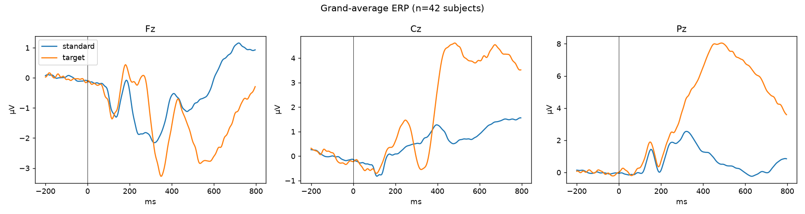
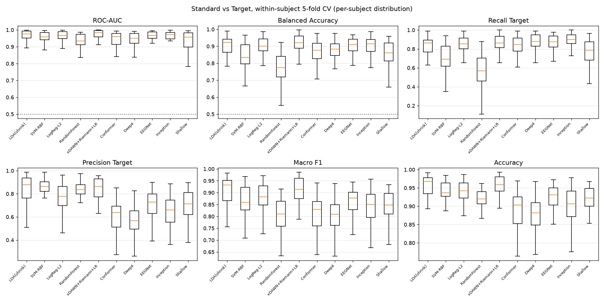

# Báo cáo: Phân loại đơn thử EEG – kích thích **Standard vs Target** (Nencki-Symfonia, oddball 3 kích thích)

## 1. Mục tiêu
Phân loại từng thử (single-trial) EEG thành **standard** hoặc **target** trong oddball.
So với phiên bản trước, lần này:
- **Chỉ dùng 2 loại kích thích standard và target.** Deviant/distractor bị loại khỏi toàn bộ huấn luyện và đánh giá; nhãn được kiểm tra chặt trong `common.load`.
- Báo cáo đủ **6 chỉ số**: ROC-AUC, Balanced Accuracy, Recall Target, Precision Target, Macro F1, Accuracy.
- Chạy lại **toàn bộ 10 mô hình**: 5 ML và 5 DL.

## 2. Dữ liệu
- Nguồn: Nencki-Symfonia EEG/ERP (GigaDB 100990, Dzianok et al., *GigaScience* 2022), bản mirror trên Kaggle `trungdttik55/nencki-symfonia-eeg-oddball` (định dạng BIDS, BrainVision).
- 42 người tham gia, 127 kênh, tần số lấy mẫu 1000 Hz.
- Mã sự kiện: `S 5` = standard, `S 6` = target, `S 7` = deviant (bỏ).
- Mỗi người thường có **498 standard + 81 target** (tỉ lệ ≈ 6,1 : 1). Ngoại lệ: sub-23 có 517/86, sub-24 có 497/81, sub-37 có 497/81, sub-38 có 583/96.

## 3. Tiền xử lý (`src/preprocess.py`)
1. Lọc chặn 50 Hz, lọc thông dải 0,1–40 Hz.
2. Hạ mẫu xuống 250 Hz. Bước này làm trên dữ liệu liên tục, sau bộ lọc 40 Hz, để tiết kiệm RAM.
3. Tham chiếu trung bình (average reference).
4. ICA (FastICA, 30 thành phần, fit trên bản lọc ≥ 1 Hz). Thành phần chớp mắt được phát hiện theo tương quan với Fp1/Fp2 và loại bỏ; trung bình khoảng 2 thành phần mỗi người.
5. Cắt epoch −200…796 ms (250 mẫu), hiệu chỉnh baseline −200…0 ms.

ERP trung bình toàn nhóm (n = 42) cho thấy rõ sóng **P300** với target ở vùng đỉnh–trung tâm. Ở Pz, chênh lệch target − standard trong cửa sổ 300–500 ms là **+4,97 µV**.

## 4. Mô hình
| Nhóm | Mô hình | Đầu vào / đặc trưng |
|---|---|---|
| ML | LDA (shrinkage) | Biên độ trung bình theo các cửa sổ 50 ms (0–800 ms) × 127 kênh, chuẩn hoá z |
| ML | SVM-RBF (class_weight=balanced) | như trên |
| ML | Logistic Regression L2 (C=0,01, balanced) | như trên |
| ML | Random Forest (300 cây, balanced) | như trên |
| ML | xDAWN + Riemann (tangent space) + LR | PCA không gian 60 chiều → xDAWN covariance (4 bộ lọc) → tangent space |
| DL | EEGNet, ShallowFBCSPNet, Deep4Net, EEG-Inception-ERP, EEG-Conformer (braindecode 2.0) | Tín hiệu thô đã z-score theo kênh; AdamW (lr 1e-3), 40 epoch, cross-entropy có trọng số lớp, chọn epoch theo AUC trên 15% tập validation tách từ tập huấn luyện |

**Giao thức đánh giá:** trong từng người (*within-subject*), Stratified 5-fold CV (seed 0). Các chỉ số được tính trên từng fold, lấy trung bình 5 fold cho mỗi người, rồi báo cáo mean ± SD trên 42 người. Ngưỡng quyết định là **0,5** trên xác suất target. Lớp dương (positive class) cho Recall/Precision là **target**.

## 5. Kết quả (n = 42 người, mean ± SD)

| Mô hình | Loại | ROC-AUC | Balanced Acc | Recall Target | Precision Target | Macro F1 | Accuracy |
|---|---|---|---|---|---|---|---|
| **xDAWN+Riemann+LR** | ML | **0,964 ± 0,063** | **0,905 ± 0,075** | 0,841 ± 0,125 | 0,827 ± 0,141 | **0,900 ± 0,078** | **0,951 ± 0,040** |
| LDA (shrink) | ML | 0,959 ± 0,056 | 0,895 ± 0,077 | 0,817 ± 0,133 | 0,839 ± 0,136 | 0,897 ± 0,078 | **0,951 ± 0,037** |
| LogReg-L2 | ML | 0,952 ± 0,055 | 0,892 ± 0,070 | 0,833 ± 0,108 | 0,755 ± 0,141 | 0,874 ± 0,076 | 0,934 ± 0,044 |
| SVM-RBF | ML | 0,946 ± 0,062 | 0,831 ± 0,097 | 0,680 ± 0,193 | **0,842 ± 0,125** | 0,853 ± 0,096 | 0,940 ± 0,029 |
| Random Forest | ML | 0,924 ± 0,065 | 0,767 ± 0,094 | 0,553 ± 0,190 | 0,821 ± 0,104 | 0,797 ± 0,093 | 0,921 ± 0,026 |
| **EEGNet** | DL | 0,955 ± 0,053 | 0,896 ± 0,063 | 0,863 ± 0,088 | 0,707 ± 0,131 | 0,859 ± 0,074 | 0,919 ± 0,051 |
| EEG-Inception | DL | 0,952 ± 0,058 | 0,894 ± 0,068 | **0,885 ± 0,091** | 0,648 ± 0,141 | 0,837 ± 0,082 | 0,900 ± 0,062 |
| EEG-Conformer | DL | 0,933 ± 0,069 | 0,860 ± 0,081 | 0,823 ± 0,119 | 0,608 ± 0,147 | 0,808 ± 0,086 | 0,887 ± 0,059 |
| Deep4Net | DL | 0,932 ± 0,071 | 0,866 ± 0,076 | 0,869 ± 0,098 | 0,558 ± 0,137 | 0,789 ± 0,088 | 0,864 ± 0,072 |
| ShallowFBCSPNet | DL | 0,920 ± 0,094 | 0,837 ± 0,109 | 0,733 ± 0,193 | 0,689 ± 0,170 | 0,823 ± 0,103 | 0,911 ± 0,052 |

*Mốc tham chiếu:* luôn đoán "standard" cho Accuracy ≈ 0,86, Balanced Accuracy = 0,5, Recall Target = 0. Vì vậy với dữ liệu mất cân bằng này, Accuracy là chỉ số kém tin cậy nhất.

### Kiểm định thống kê
- **Friedman** trên ROC-AUC theo từng người, 10 mô hình: p = 3·10⁻⁴². Các mô hình khác nhau có ý nghĩa thống kê.
- **Hạng trung bình theo AUC** (1 = tốt nhất): xDAWN+Riemann 1,95 · LDA 2,95 · EEGNet 4,05 · LogReg 4,33 · Inception 4,69 · SVM 5,33 · Conformer 7,38 · Shallow 7,71 · Deep4 7,79 · RF 8,81.
- **Wilcoxon signed-rank**, so sánh DL tốt nhất (EEGNet) với ML tốt nhất (xDAWN+Riemann+LR), n = 42:

| Chỉ số | Chênh lệch TB (EEGNet − xDAWN) | p |
|---|---|---|
| ROC-AUC | −0,009 | 1,2·10⁻⁵ |
| Balanced Accuracy | −0,009 | 0,0018 |
| Recall Target | **+0,022** | 0,030 |
| Precision Target | −0,120 | 2,0·10⁻¹¹ |
| Macro F1 | −0,042 | 7,7·10⁻¹¹ |
| Accuracy | −0,031 | 1,5·10⁻¹¹ |

## 6. Thảo luận
1. **Bài toán standard vs target tách biệt tốt.** 34/42 người đạt AUC ≥ 0,95 với mô hình tốt nhất của họ. Chỉ sub-07 dưới 0,8 (AUC tốt nhất 0,71); tiếp theo là sub-01 (0,84) và sub-41 (0,90). Nguyên nhân khả dĩ là P300 yếu hoặc nhiễu cao ở những người này.
2. **ML cổ điển dựa trên ERP vẫn ngang hoặc nhỉnh hơn DL.** Mức này xảy ra khi chỉ có khoảng 460 thử huấn luyện mỗi fold. xDAWN+Riemann tốt nhất trên ROC-AUC, Balanced Accuracy, Macro F1 và Accuracy. EEGNet là DL tốt nhất, kém xDAWN khoảng 0,01 AUC; chênh lệch nhỏ nhưng có ý nghĩa thống kê. Các mạng lớn (Deep4, Conformer) và Shallow (thiết kế cho nhịp vận động, không cho ERP) kém hơn rõ rệt.
3. **Đánh đổi Recall và Precision do cách xử lý mất cân bằng lớp, ở ngưỡng 0,5:**
   - Các mạng DL dùng loss có trọng số lớp nên dịch về phía target. Recall Target cao (Inception 0,885; Deep4 0,869; EEGNet 0,863) nhưng Precision thấp (0,56–0,71), kéo Macro F1 và Accuracy xuống.
   - LDA không cân bằng lớp, còn SVM/RF bảo thủ, nên Precision cao (0,82–0,84) nhưng Recall thấp hơn (RF chỉ 0,55).
   - ROC-AUC không phụ thuộc ngưỡng, và trên chỉ số này các mô hình top gần như ngang nhau. Vì vậy phần lớn khác biệt ở Precision/F1/Accuracy đến từ **vị trí ngưỡng**, không phải từ khả năng tách lớp.
4. **Chọn chỉ số chính:** ROC-AUC và Balanced Accuracy phản ánh đúng nhất khi lớp mất cân bằng 6:1. Accuracy cao (0,95) chỉ hơn mốc "đoán toàn standard" (0,86) khoảng 9 điểm. Nếu ứng dụng cần phát hiện target (ví dụ P300-speller, BCI) thì ưu tiên Recall; nếu cần ít báo động giả thì ưu tiên Precision. Có thể chỉnh ngưỡng theo mục tiêu.
5. **So với lần chạy trước** (`results/v1_old/`, cũng là standard vs target): BA và AUC gần như trùng, ví dụ xDAWN 0,906/0,964 trước so với 0,905/0,964 nay, EEGNet 0,895/0,956 so với 0,896/0,955. Pipeline mới (hạ mẫu trước ICA) cho kết quả ổn định.
